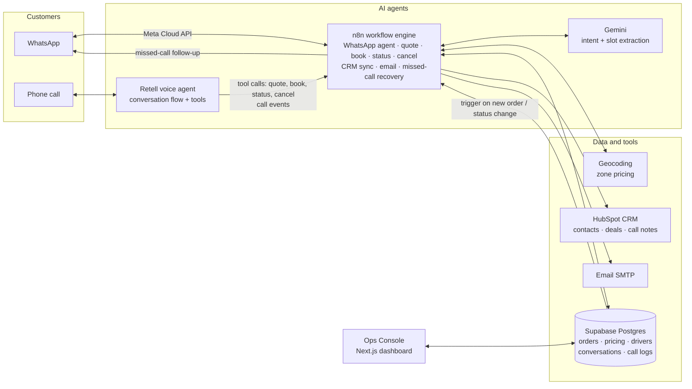

# Acme Courier System — an AI front office for courier companies

> Customers book, track and cancel deliveries by **WhatsApp** or **phone**, any time of day,
> without waiting for a dispatcher. Every order lands in the database and the **CRM**, customers
> get **email** updates, missed calls get a **WhatsApp follow-up**, and the team runs it all from one **ops console**.

Built by **[Nexordis](https://nexordis.com)** as a full working demo for a fictional Toronto courier,
*Acme Courier Co.* All customer data in this repo is synthetic.

---

## What it does for a courier business

| Problem | What the system does |
|---|---|
| Calls go unanswered after hours or when dispatch is busy | A **voice AI agent** answers every call: quotes, books, tracks and cancels orders |
| Customers prefer messaging | A **WhatsApp assistant** does the same over chat, with a menu for one-tap actions |
| Quoting is slow and inconsistent | **Instant zone-based pricing**: addresses are geocoded, distance from the depot sets the zone, and the price comes from the company's own rate table |
| "Where's my order?" calls eat dispatcher time | Customers get the **live status** themselves, by order number or phone number |
| Cancellations cause disputes | The company's **cancellation policy is applied automatically**: free before a driver is assigned, $10 after, full price once in transit |
| Leads and orders never reach the CRM | Every customer becomes a **HubSpot contact** and every booking a **deal** that moves through *Booked → In transit → Delivered* by itself |
| Customers don't know what's happening | **Automatic emails**: booking confirmation, then in-transit and delivered updates |
| Missed calls are lost revenue | Callers who hang up or aren't served get a **WhatsApp message** inviting them to continue in chat |
| No overview of the operation | An **ops console** with analytics, a dispatch board, call logs and live conversations |

### A booking on WhatsApp, end to end

```
Customer: Hi, I need to send a small box from 123 Bay St to 5000 Yonge St today
Bot:      Got it! Same-day Standard or Express?
Customer: express
Bot:      What name should I put the booking under?
Customer: Cameron White
Bot:      Almost done, Cameron! Would you like a confirmation by email? Share your email, or reply "skip".
Customer: cameron@example.com
Bot:      Here's your booking:
          • Pickup: 123 Bay St, Toronto  • Drop-off: 5000 Yonge St, North York
          • Small package · Same-Day Express · $40.00 (zone 3)
          Reply YES to confirm, or tell me what you'd like to change.
Customer: yes
Bot:      You're booked, Cameron! Order #10701 ... A confirmation is on its way to cameron@example.com.
```

Behind that one conversation: the order is saved, a HubSpot contact and deal are created and linked,
the confirmation email is sent, and the order appears on the dispatch board. When dispatch marks it
picked up, the deal moves stage, the customer gets an email, and the bot answers "where's my order?" with the new status.

---

## Architecture



**Design principle: one source of truth, event-driven.** Every channel writes orders to Postgres.
A database trigger publishes each new order and status change to n8n, which updates HubSpot,
emails the customer and keeps the agents' answers current. The dashboard (or a client's own dispatch
system) only has to change an order's status; everything downstream happens automatically.

---

## What's in this repo

| Folder | Contents |
|---|---|
| [`n8n/`](n8n) | The main workflow export: WhatsApp agent, voice-agent tool endpoints, pricing, booking, status, cancellation, HubSpot sync, email, missed-call recovery |
| [`voice-agent/`](voice-agent) | The Retell conversation-flow agent: nodes, transitions, tools and prompts |
| [`dashboard/`](dashboard) | Ops Console: Next.js 16 + TypeScript + Tailwind, with analytics, dispatch board, calls, conversations |
| [`database/`](database) | Postgres schema as ordered migrations, plus seed data (tenant, pricing table, drivers) |
| [`knowledge-base/`](knowledge-base) | The company knowledge base the agents answer from (policies, service area, pricing, FAQs) and sample call transcripts |
| [`tools/`](tools) | Synthetic order generator used to populate realistic demo data |
| [`docs/`](docs) | How each flow works, and how the system was made reliable |

---

## Tech stack

| Layer | Technology |
|---|---|
| Voice agent | **Retell AI** conversation flow, custom tools calling n8n webhooks |
| Messaging | **WhatsApp Business Cloud API** (Meta): free-form replies, interactive list menu, approved templates |
| Orchestration | **n8n** (self-hosted): webhooks, routing, code nodes and integrations |
| Language model | **Google Gemini** (Flash-Lite) for intent classification and slot extraction, with a fallback model |
| Database | **Supabase Postgres**: row-level security, `pg_net` triggers as an event bus |
| CRM | **HubSpot**: contacts and deals upserted by custom unique properties, a custom *Deliveries* pipeline, call notes |
| Email | SMTP (Gmail for the demo; a client's own domain in production) |
| Pricing | OpenStreetMap **Nominatim** geocoding plus distance bands from the depot, combined with a rate table |
| Dashboard | **Next.js 16**, React 19, TypeScript, Tailwind CSS v4, Recharts, server actions; deployed on **Vercel** |

---

## Making an LLM agent reliable enough for real orders

Language models are good at understanding messy messages but bad at money and state. So the model
only *interprets*; deterministic code *decides*.

- **The model extracts, code enforces.** Gemini returns intent and fields as JSON. A code step
  (`Enforce Required Fields`) validates them against allowed values, normalises them, decides what's
  still missing and asks for it. Prices always come from the rate table, never from the model.
- **Confirmation before commitment.** Bookings show a full summary and need an explicit "YES".
  Changing anything at that point re-prices and re-summarises.
- **One model call per message.** The knowledge base is loaded *before* classification, so FAQs are
  answered in the same call. This halved response time.
- **Conversation memory without drift.** Slots persist per customer, are reset after each booking
  (no duplicate or stale orders), and the bot's last reply is stored so "sure", "thanks" or "cancel it" are understood.
- **Honesty rules.** The bot never promises what the system can't do, and closes the conversation politely.
- **Policy in one place.** Cancellation fees are calculated the same way for WhatsApp, voice and the dashboard.
- **Fallbacks and logging.** A secondary model takes over if the primary one fails. Unclear messages go
  into a review queue to improve the knowledge base.
- **A test harness.** Test numbers (`999…`) run the whole flow without sending real WhatsApp messages
  or creating CRM records, so every path can be tested end to end.

More detail is in [`docs/how-it-works.md`](docs/how-it-works.md).

---

## Running it yourself

1. **Database:** create a Supabase project and run `database/migrations/*.sql` in order, then `database/seed.sql`.
2. **n8n:** import the workflow in `n8n/`, create the credentials it references (Supabase, HubSpot app
   token, SMTP, WhatsApp token, Gemini), and replace the `<PLACEHOLDER>` values. Then activate the workflow.
3. **Voice agent:** import `voice-agent/` into Retell and point the tool URLs at your n8n host.
4. **WhatsApp:** set the Meta webhook to `https://<N8N_HOST>/webhook/acme/whatsapp`.
5. **Dashboard:** see [`dashboard/README.md`](dashboard/README.md); deploys to Vercel in a few minutes.

No secrets are committed. Every token, key and webhook secret has been replaced with a `<PLACEHOLDER>`.

---

## Status

A working demo, tested end to end across WhatsApp, voice, CRM, email and dispatch. For a real client,
the system is deployed on dedicated infrastructure and connected to the client's own dispatch system,
CRM and email domain.

**Contact:** [Nexordis](https://nexordis.com), AI automation for logistics.
