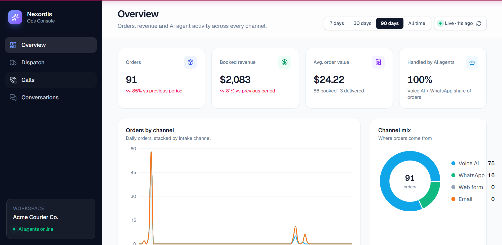
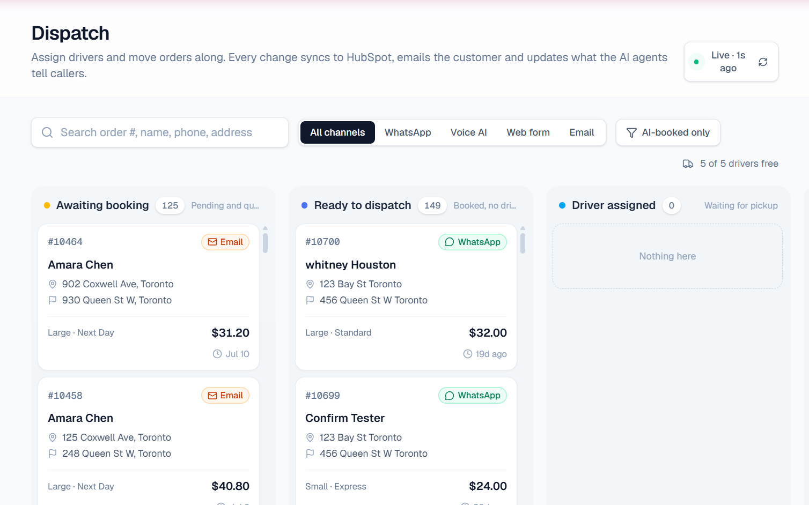

# Nexordis Ops Console

Operations dashboard for the Nexordis AI courier stack (demo client: Acme Courier Co.).
It stands in for a client's dispatch system during demos, and is the base for each client build.

**Stack:** Next.js 16 (App Router, server components + server actions) · React 19 · TypeScript ·
Tailwind CSS v4 · Recharts · lucide icons · Geist font · Supabase (Postgres) via the service role key on the server only.

## Screens




| Screen | What it does |
|---|---|
| **Overview** | Orders, booked revenue, average order value, AI-handled share, orders by channel per day, channel mix, pipeline by status, cancellation rate and fees, revenue by service, latest orders, busiest hours. 7/30/90-day and all-time ranges, with change vs the previous period. |
| **Dispatch** | Kanban board: Awaiting booking → Ready to dispatch → Driver assigned → In transit → Delivered / Cancelled. Click an order to confirm it, assign or reassign a driver, mark it picked up or delivered, or cancel it with the policy fee shown first. Search and channel filters. |
| **Calls** | Voice AI call log with transcripts and outcomes, plus missed-call WhatsApp follow-ups and their result. |
| **Conversations** | Live WhatsApp conversations with what the bot has collected so far, the review queue of unclear messages, and every customer email sent. |

Pages refresh automatically (8–20 s) while open. Links open the customer in HubSpot.

## How it connects to everything else

Every button writes to the `orders` table in Supabase. The existing database trigger
`notify_order_status_change` then calls n8n, which:

- moves the HubSpot deal (Booked → In transit → Delivered / Cancelled),
- emails the customer the status update,
- and the WhatsApp bot and voice agent read the new status when customers ask.

Cancellation uses the same policy as the bots (`lib/policy.ts`): free before a driver is assigned,
$10 once one is assigned, full price in transit, and delivered orders can't be cancelled.
The fee is calculated on the server.

The dashboard holds no business logic that the bots don't also follow, so for a client
deployment you swap Supabase for their database or API in `lib/data.ts` and `lib/actions.ts`.

## Run locally

```bash
npm install
cp .env.example .env.local     # then fill in SUPABASE_SERVICE_ROLE_KEY
npm run dev                    # http://localhost:3000
```

The server key is in Supabase → Project Settings → API Keys → **Secret key** (`sb_secret_…`, or the legacy `service_role` key). It bypasses
row-level security, so keep it in env vars only. Never prefix it with `NEXT_PUBLIC_` and never commit it.

## Deploy free on Vercel

1. vercel.com → Add New → Project → import the repo.
2. Set **Root Directory** to `dashboard`. The framework is detected automatically.
3. Under Environment Variables, add everything from `.env.example`, including `SUPABASE_SERVICE_ROLE_KEY`.
4. Deploy. You get a URL like `nexordis-ops.vercel.app`.

**Access:** there's no login by default. Anyone with the URL can view the data and change orders.
To lock it, set `DASHBOARD_USER` and `DASHBOARD_PASSWORD`; the browser will then ask for them.

## Project layout

```
app/                 pages (overview, dispatch, calls, conversations), layout, error/loading states
components/          UI kit, sidebar, charts, dispatch board + order panel, toasts, live refresh
lib/data.ts          all database reads (server only)
lib/actions.ts       all writes: confirm, assign/unassign driver, picked up, delivered, cancel
lib/policy.ts        cancellation policy (shared by the UI preview and the server)
proxy.ts             optional password lock
```
