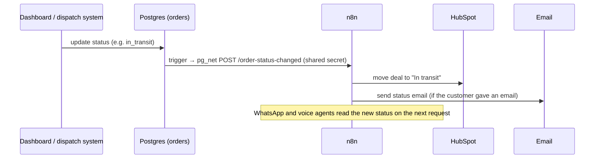

# How it works

## 1. WhatsApp agent (n8n)

```mermaid
flowchart TD
  IN[Meta webhook: incoming message] --> P[Parse payload<br/>text or menu tap]
  P --> C{Known customer?}
  C -- new, just "hi" --> MENU[Welcome + interactive menu]
  C -- yes / has a request --> KB[Load knowledge base + conversation state]
  KB --> G[Gemini: intent + fields as JSON<br/>FAQ answered in the same call]
  G --> E[Enforce Required Fields<br/>validate · normalise · decide next question]
  E --> R{Route intent}
  R -- quote --> Q[Geocode both addresses → zone → rate table]
  R -- book --> B[Ask name, optional email → summary → YES → create order]
  R -- status --> S[Look up by order # or phone]
  R -- cancel --> X[Apply policy → confirm → cancel + fee]
  R -- faq / other --> F[Answer from KB, or polite redirect + review log]
  Q & B & S & X & F --> OUT[Save state + reply on WhatsApp]
```

**Conversation state** lives in `wa_conversations`: the current intent, the slots collected so far,
the bot's last reply and the last order number. That lets a customer say "make it express" at the
summary, or "cancel it" after booking, and be understood.

**Guardrails:**
- Allowed values (package size S/M/L/XL, three service tiers) are enforced in code; anything else is re-asked.
- Every booking needs an explicit "YES" after a full summary. Any change re-prices and shows the summary again.
- Slots are reset after a successful booking, so a later quote doesn't reuse old addresses.
- Messages from test numbers (`999…`) run the whole workflow but skip the real WhatsApp send and CRM writes.

## 2. Voice agent (Retell)

A conversation flow (start → collect pickup → drop-off → package → quote → confirm → book, plus
status, policy questions, cancellation and escalation branches) that calls n8n webhooks as tools:

| Tool | What it does |
|---|---|
| `get_quote` | Price for a route, size and tier, or out-of-area |
| `book_order` | Creates the order and returns its number |
| `check_order_status` | Status and ETA by order number or phone |
| `check_cancellation` | Whether the order can be cancelled, and the fee |
| `confirm_cancellation` | Cancels it after the caller agrees |

After each call, Retell posts `call_analyzed` to n8n, which logs the call (transcript, outcome,
duration), adds a note to the HubSpot contact, and runs missed-call recovery.

## 3. Pricing

1. Both addresses are geocoded (Nominatim, bounded to the Greater Toronto Area).
2. The distance from the depot sets the zone: up to 4 km is zone 1, up to 10 km zone 2, up to 20 km zone 3,
   up to 50 km zone 4. The farther address decides. Anything outside the area is politely declined.
3. Price = `base_rate(zone, size) × tier_multiplier` from `pricing_config`. Express is ×1.6 and next day ×0.85.

## 4. Event bus: order status → everything else



## 5. HubSpot CRM

- **Contacts** are upserted by a unique custom property (`acme_customer_phone`), so WhatsApp and voice
  customers with the same number merge into one contact.
- **Deals** are upserted by `acme_order_number` in a custom *Deliveries* pipeline:
  Quoted → Booked → In transit → Delivered (won) / Cancelled (lost).
- **Call notes:** every voice call adds a note to the contact with its summary and transcript.

## 6. Cancellation policy

| Order state | Result |
|---|---|
| Booked, no driver yet | Free cancellation |
| Driver assigned | $10 fee |
| In transit | Full price |
| Delivered | Can't be cancelled |

The customer is told the fee and must confirm before anything changes. The phone number must match
the order (last 10 digits), so nobody can cancel someone else's delivery.

## 7. Missed-call recovery

When a call ends unsuccessfully (no answer, busy, voicemail, an error, the agent marking it
unsuccessful, or the caller hanging up within 30 seconds), n8n checks that the caller didn't book
on that call and hasn't had a follow-up in the last 24 hours. It then sends an approved WhatsApp
template inviting them to continue in chat. Every attempt is logged in `missed_call_followups`.

## 8. Ops Console

See [`dashboard/README.md`](../dashboard/README.md). Every action updates the order row, and the
event bus above does the rest, so a client's own dispatch software can replace the dashboard without
any other changes.
