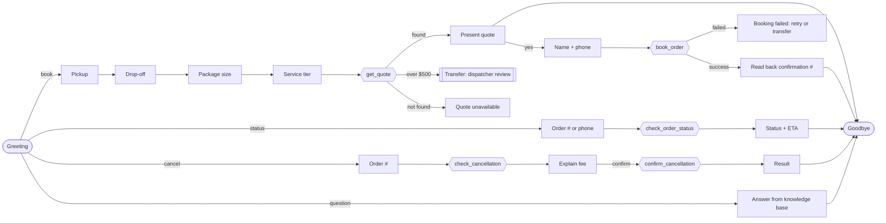

# Voice agent — Retell conversation flow

`acme-intake-agent.json` is the Retell export of **"Acme Courier Intake Agent (cancellation)"**: "Ava",
the phone agent for Acme Courier Co. It's a **conversation-flow** agent (GPT-4.1, temperature 0.2):
29 nodes, 5 tools calling n8n, global escalation rules, and a webhook that sends every finished
call to n8n for logging, CRM notes and missed-call recovery.

## Call flow

A **global node** catches complaints, disputes, damaged/lost packages, driver-conduct issues and data
deletion requests at any point, and transfers the caller to a human dispatcher.

## Tools (all `POST` to n8n)

| Tool | Endpoint | Returns |
|---|---|---|
| `get_quote` | `/webhook/acme/get-quote` | `price`, `zone`, `found` |
| `book_order` | `/webhook/acme/book-order` | `order_id`, `confirmation_message`, `success` |
| `check_order_status` | `/webhook/acme/check-status` | `status`, `eta`, `found` |
| `check_cancellation` | `/webhook/acme/cancel-order` | `can_cancel`, `fee`, `message` (no change made) |
| `confirm_cancellation` | `/webhook/acme/cancel-order?confirm=1` | `cancelled`, `message` |

## Reliability rules built into the prompt and flow

- **Routing follows the tool result, not the model's judgment.** Each function node branches on the
  actual `found` / `success` / `can_cancel` value, so a failed lookup is never "softened" into a success.
- **Every price comes from the latest `get_quote` result.** Any change (address, size, tier) forces a new quote.
- **Quotes over $500** go to a human dispatcher for review before confirmation.
- **No hang-ups mid-answer:** the agent never ends the call while a question is unanswered or a
  confirmation number hasn't been read out.
- **"I'd rather talk to a human"** gets a choice (transfer now, or continue quickly), not an automatic transfer.
- **No payment card numbers** are taken over the phone.

## Importing

In Retell: **Agents → Import**, choose `acme-intake-agent.json`, then replace `<N8N_HOST>` in the tool
URLs and the agent webhook URL with your n8n host. Set `escalation_phone` (a fictional 555 number here)
to a real dispatcher line, and attach your knowledge base to the *answer_policy_question* node.

IDs and the server address have been replaced with placeholders.
